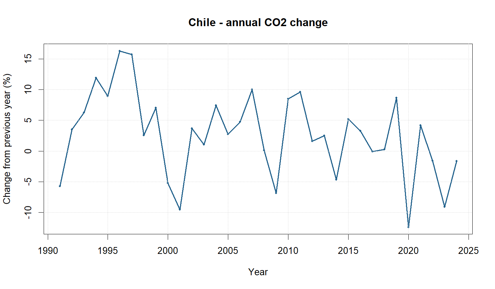

# CO2 Emissions Analysis: Chile

**Student:** [YOUR NAME]  
**Country / ISO-3:** Chile / CHL  
**Study period:** 1990–2024  
**Declared to instructor on:** [DATE — confirm that Chile was approved]

## Research question

How have annual CO2 emissions and per-capita CO2 emissions changed in Chile from 1990 to 2024?

## Data source and definitions

Our World in Data (OWID), [CO2 and Greenhouse Gas Emissions dataset](https://github.com/owid/co2-data). The analysis script downloads the full dataset from the official OWID data endpoint and extracts only Chile's records.

- **Source dataset:** https://owid-public.owid.io/data/co2/owid-co2-data.csv
- **Download date:** [ADD DATE AFTER RUNNING THE SCRIPT]
- **Selected columns:** `country`, `iso_code`, `year`, `co2`, and `co2_per_capita`.
- **`co2`:** annual CO2 emissions from fossil fuels and industrial processes, excluding land-use change, in million tonnes.
- **`co2_per_capita`:** annual CO2 emissions per person, in tonnes/person/year.

These are emissions estimates, not atmospheric CO2 concentrations or measurements of all greenhouse gases. Missing values are retained as missing and are not changed to zero.

## Software

- R and RStudio
- Git, configured for use by RStudio

The analysis uses base R and does not require additional R packages.

## How to reproduce the analysis

1. Clone this repository and open it as an RStudio Project.
2. Ensure RStudio's working directory is the repository root.
3. Connect to the internet for the initial full-dataset download.
4. In the RStudio Console, run:

```r
source("scripts/analyze_co2.R")
```

The script creates the country-only dataset in `data/`, figures in `figures/`, and numerical outputs in `results/`. The complete multi-country source file, `data/owid-co2-data.csv`, must remain local and must not be committed.

## Results

[Complete this section using the generated CSV files. Do not estimate or invent values.]

- Earliest year with valid annual emissions: [YEAR], [VALUE] million tonnes CO2/year.
- Latest year with valid annual emissions: [YEAR], [VALUE] million tonnes CO2/year.
- Change between those endpoints: [VALUE]%.
- Peak annual emissions: [YEAR], [VALUE] million tonnes CO2/year.
- Latest available per-capita estimate: [YEAR], [VALUE] tonnes/person/year.

## Figures




## Interpretation (200–300 words)

[Write this after running the analysis. Address: earliest and latest valid years and values; endpoint percentage change; peak year and value; the difference between absolute and per-capita emissions; one sustained trend and one notable change or unusual year; one plausible environmental, energy, economic, or policy context supported by an independent source; why national emissions matter for climate change and ecology; and at least one limitation of country-level territorial data. Distinguish observed patterns from possible explanations and do not claim that the analysis proves causation.]

## Limitations

The OWID `co2` indicator covers fossil-fuel and industrial-process emissions and excludes land-use change; it is not a measure of all greenhouse gases. Territorial accounting assigns emissions to the country where they occur and does not, by itself, capture emissions embodied in imported goods. Missing observations are not treated as zero. Country-level annual data also cannot identify the cause of a change without additional evidence.

## References

- Our World in Data. [CO2 and Greenhouse Gas Emissions dataset](https://github.com/owid/co2-data).
- [Add one independent, credible source used to contextualize a notable change in Chile's emissions.]
