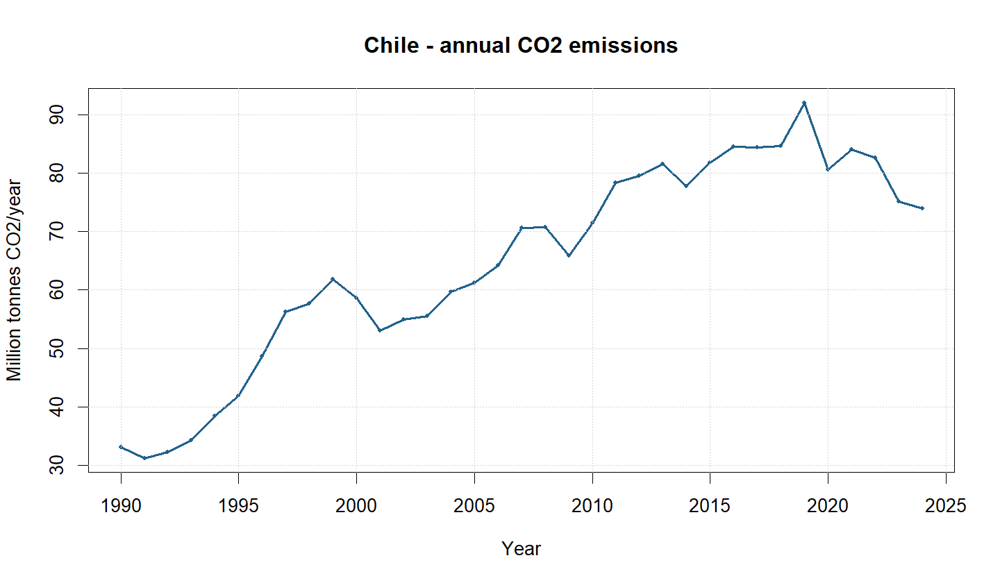
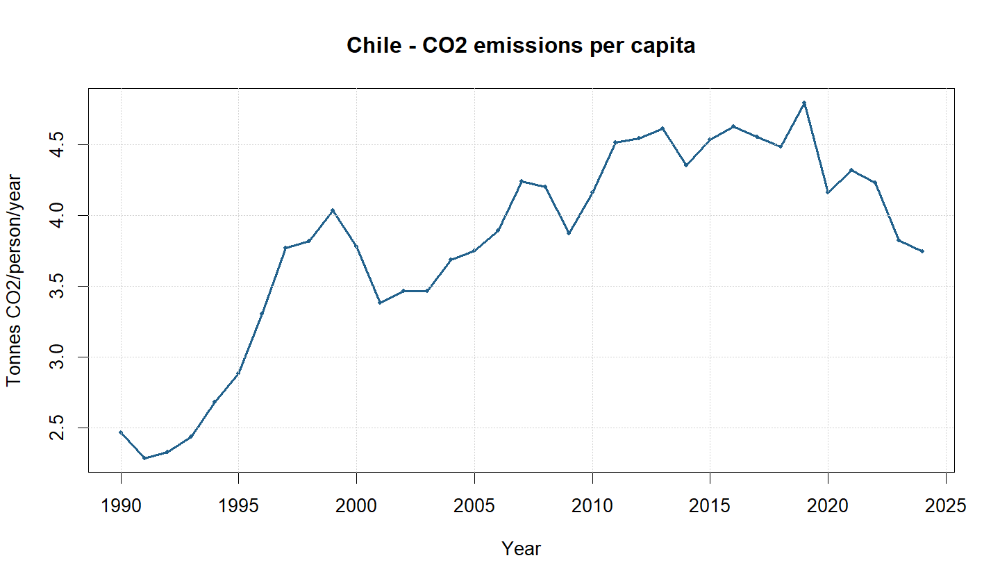

# CO2 Emissions Analysis: Chile

**Student:** Michelle Anne E. Dorado 
**Country / ISO-3:** Chile / CHL  
**Study period:** 1990–2024  
**Declared to instructor on:** November 14, 2026

## Research question

How have annual CO2 emissions and per-capita CO2 emissions changed in Chile from 1990 to 2024?

-From 1990 to 2024, Chile's annual CO₂ emissions and per-capita CO₂ emissions generally increased, reflecting the country's growing energy demand, industrial activity, transportation, and economic development. Annual emissions represent the total amount of CO₂ released by the country each year, while per-capita emissions represent the average emissions per person. Changes in these indicators show how Chile's overall carbon emissions and individual contribution to emissions have evolved over time. However, the trends may include periods of decline or fluctuation due to changes in economic activity, energy consumption, and the energy mix.

## Data source and definitions

Our World in Data (OWID), [CO2 and Greenhouse Gas Emissions dataset](https://github.com/owid/co2-data). The analysis script downloads the full dataset from the official OWID data endpoint and extracts only Chile's records.

- **Source dataset:** https://owid-public.owid.io/data/co2/owid-co2-data.csv
- **Download date:** November 14, 2026
- **Selected columns:** `country`, `iso_code`, `year`, `co2`, and `co2_per_capita`.
- **`co2`:** annual CO2 emissions from fossil fuels and industrial processes, excluding land-use change, in million tonnes.
- **`co2_per_capita`:** annual CO2 emissions per person, in tonnes/person/year.

These are emissions estimates, not atmospheric CO2 concentrations or measurements of all greenhouse gases. Missing values are retained as missing and are not changed to zero.

## Software

- R and RStudio
- Git, configured for use by RStudio

The analysis uses base R and does not require additional R packages.

## How to reproduce the analysis

1. Clone this repository and open it as an RStudio Project.
2. Ensure RStudio's working directory is the repository root.
3. Connect to the internet for the initial full-dataset download.
4. In the RStudio Console, run:

```r
source("scripts/analyze_co2.R")
```

The script creates the country-only dataset in `data/`, figures in `figures/`, and numerical outputs in `results/`. The complete multi-country source file, `data/owid-co2-data.csv`, must remain local and must not be committed.

## Results

- Earliest year with valid annual emissions: 1990, 33.10 million tonnes CO₂/year.
- Latest year with valid annual emissions: 2024, 73.95 million tonnes CO₂/year.
- Change between those endpoints: 123.45% increase.
- Peak annual emissions: 2019, 92.01 million tonnes CO₂/year.
- Latest available per-capita estimate: 2024, 3.74 tonnes/person/year.
## Figures






## Interpretation (200–300 words)

Chile's annual CO₂ emissions increased from 33.10 million tonnes in 1990 to 73.95 million tonnes in 2024, representing a 123.45% increase. However, emissions did not increase continuously. They reached their highest recorded level in 2019 at 92.01 million tonnes, followed by a 12.39% decline in 2020. Emissions partially recovered in 2021 but decreased again from 2022 to 2024.

Per-capita emissions showed a similar long-term pattern. They increased from 2.46 tonnes per person in 1990 to a peak of approximately 4.79 tonnes in 2019, before declining to 3.74 tonnes in 2024. Annual emissions measure the country's total contribution, whereas per-capita emissions represent the average emissions per resident.

The 2020 decline is consistent with the OECD's report of a temporary decrease in Chile's greenhouse gas emissions during the COVID-19 pandemic. The International Energy Agency also identifies coal power plant retirements and the expansion of solar and wind energy as important factors in Chile's declining energy-related emissions since 2019. These developments provide possible context rather than proof of causation in this analysis.

Overall, the long-term increase indicates greater cumulative pressure from fossil-fuel and industrial CO₂ emissions. These emissions contribute to atmospheric CO₂ accumulation and climate change, which can alter temperature, precipitation, habitats, and species distributions. However, this analysis covers only territorial fossil-fuel and industrial-process CO₂ emissions. It excludes land-use change and other greenhouse gases, while national averages can conceal differences among sectors and regions.
## Limitations

The OWID co2 indicator covers fossil-fuel and industrial-process emissions and excludes land-use change; it is not a measure of all greenhouse gases. Territorial accounting assigns emissions to the country where they occur and does not, by itself, capture emissions embodied in imported goods. Missing observations are not treated as zero. Country-level annual data also cannot identify the cause of a change without additional evidence.
## References

- Our World in Data. CO₂ and Greenhouse Gas Emissions dataset.

- International Energy Agency. (2026). Chile 2050 Energy Transition Roadmap.

- OECD. (2025). OECD Economic Surveys: Chile 2025 – Achieving a green transition for a more prosperous Chile.
